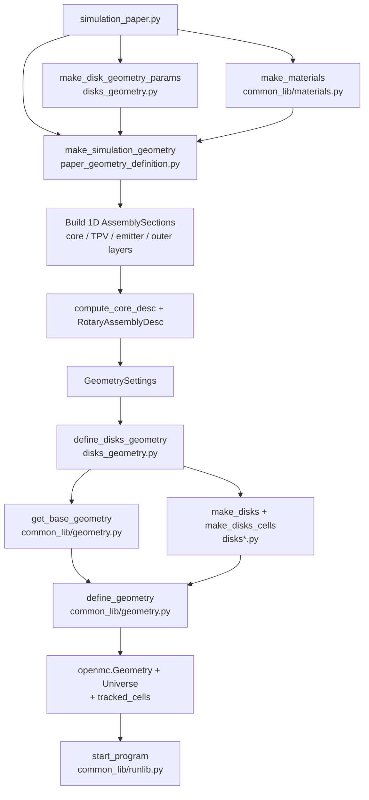
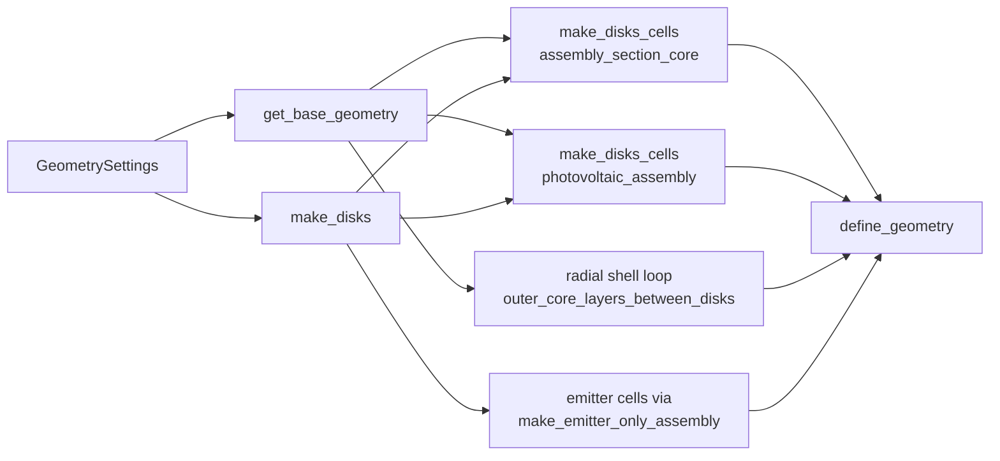

# RIMAG reactor geometry

How the OpenMC geometry used by `simulation_paper.py` (and the rest of the RIMAG program) is built.

The design is a **rotary hollow-disk / frustum reactor**: a fixed cylindrical fuel core at the origin intersects a large rotary disk (optionally conical / frustum-shaped) that carries TPV cells and radiative emitters. Axial material order is defined as 1D layer stacks first; those stacks are then extruded between conical (or planar) surfaces and clipped by radial CSG regions.

---

## Call chain from `simulation_paper.py`



| Step | Function / type | File | Role |
|------|-----------------|------|------|
| 1 | `DiskGeometryParams` + `make_disk_geometry_params` | `one_layer_disk_design/disks_geometry.py` | Scalar thicknesses, pitch, column count; light validation |
| 2 | `make_simulation_geometry` | `one_layer_disk_design/paper_geometry_definition.py` | Compose 1D stacks, core/rotary descriptors, `GeometrySettings` |
| 3 | `define_disks_geometry` | `one_layer_disk_design/disks_geometry.py` | Radial CSG boundaries + material cells for one module |
| 4 | `get_base_geometry` / `define_geometry` | `common_lib/geometry.py` | Core/disk/shaft/outer zones; vertical stack; optional multi-column; final `openmc.Geometry` |

There is a parallel entry point `one_layer_disk_design/frustum_geometry_definition.py` with the same `make_simulation_geometry` name. It is the same pipeline with slightly richer cladding layers in the intermediary / shield stacks. **Paper runs use `paper_geometry_definition`.**

---

## Design idea (physical picture)

Think in three nested ideas:

1. **Axial sandwich (1D)** — Along the disk “thickness” direction, materials alternate: moderator / fuel sandwiches / emitter gaps / fuel / … mirrored to be symmetric. A parallel sandwich with the same total thickness and the same emitter slots holds TPV + coolant instead of fuel.

2. **Radial partition (2D, xy)** — The fuel lives in a **fixed core cylinder** at the origin. A **rotary disk** is centered at `assembly_core_distance` on +x. Their intersection is the active region. Outside the core, concentric shells (reflector → neutron-shield moderator → absorber) sit between the core and the disk rim; TPV occupies the disk material outside those shells.

3. **Frustum / conical pitch (3D)** — When `frustum_pitch ≠ 0`, the “planes” that bound each axial layer are one-sided cones (`ZConeOneSided`) instead of flat `ZPlane`s. Each module becomes a frustum slice. Modules are then repeated along z with periodic boundaries so the reactor is an infinite (or tall) stack of identical slices.

```
Top view (xy), pitch = 0 for clarity
────────────────────────────────────────────────────────────

                    y
                    ▲
                    │
         ┌──────────────────────┐
         │                      │  rotary disk
         │     ┌──────────┐     │  center at x = ACD
         │     │  outer   │     │  radius = rotary_assembly_radius
         │     │  shields │     │
         │  ┌──┴──────────┴──┐  │
         │  │                │  │
    ─────┼──┤   CORE (fuel)  ├──┼──────► x
         │  │   r = core_r   │  │
         │  └──┬──────────┬──┘  │
         │     │  TPV in  │     │
         │     │  disk ∩  │     │
         │     │ ~outer   │     │
         │     └──────────┘     │
         │         shaft        │
         └──────────────────────┘

ACD = assembly_core_distance = core_radius + outer_core_thickness / 2
rotary_assembly_radius = ACD + core_radius
```

```
Side view with frustum_pitch > 0
────────────────────────────────

         cone / frustum layer boundaries
              ╲         ╱
               ╲  TPV  ╱
                ╲     ╱
         ════════╪═══╪════════  ← one module height (core_height along cone normal)
                ╱     ╲
               ╱ fuel  ╲
              ╱  core   ╲
             ╱           ╲
        ────┴─────────────┴────  next module (periodic)
              shaft axis →
```

Emitters sit in axial slots reserved by **emitter placeholders**. Those slots are filled with `void | emitter | void` so the hot emitter faces the TPV across a small vacuum gap (`fuel_emitter_gap`).

---

## Stage 1 — Input parameters (`simulation_paper.py`)

`simulation_paper.py` builds a `DiskGeometryParams` then calls `make_simulation_geometry(...)`.

Paper-relevant knobs (JSON / CLI):

- `nsm_material`, `nsm_thickness` → neutron shield moderator
- `conical_pitch` → `frustum_pitch` (degrees)
- `run_mode`, `n_batches`

Hard-coded geometry knobs in the script (typical paper values):

| Parameter | Typical value | Meaning |
|-----------|---------------|---------|
| `core_diameter` | 250 cm | Fixed core cylinder diameter |
| `fuel_thickness` | `0.017 / enrichment_multiplicator` | Fuel layer thickness |
| `total_fuel_thickness` | 1 cm | Fuel + 2× cladding envelope |
| `fuel_cladding_thickness` | `(total − fuel) / 2` | Clad each side of fuel |
| `moderator_thickness` | 1 cm | End moderator slabs (split across mirror) |
| `fuel_emitter_gap` | 0.2 cm | Void between fuel/clad and emitter |
| `emitter_thickness` | 0.8 cm | Radiative emitter |
| `thickness_photovoltaic` | 0.02 cm | TPV cell thickness |
| `rotary_axle_thickness` | 1 cm | Shaft wall |
| `reflector_thickness` | 30 cm | Outer reflector shell |
| `neutron_shield_absorber_thickness` | 10 cm | Outer B₄C (etc.) shell |
| `number_of_reactor_columns` | 1 (or 3) | Lateral copies of the column |

`make_disk_geometry_params` only sanity-checks TRISO fuel volume and that column count is 1 or 3.

---

## Stage 2 — 1D assembly stacks (`paper_geometry_definition.make_simulation_geometry`)

Everything starts as lists of `Assembly` / `EmitterPlaceholder` pieces (`AssemblySections`). Thicknesses are along the disk axis (the direction later bounded by cones/planes).

### Helper: `mirror_assembly`

Defined in `common_lib/assemblies.py`:

```
parts = [A, B, C]           # C is the half to put at the center
mirror → [A, B, C*2, B, A]
```

The last piece is doubled and the prefix is mirrored around it. Almost every stack is written as a **half**, then mirrored, so the full module is symmetric.

### Emitter block

```
void (fuel_emitter_gap) | emitter | void (fuel_emitter_gap)
```

Its total thickness becomes an `EmitterPlaceholder` that is inserted into the core / TPV / outer-between-disks stacks. Later, `make_emitter_only_assembly` expands those placeholders into the real emitter sandwich for the emitter cells.

### Core (fuel) stack

Built bottom→top as:

1. **Intermediary half**: `moderator/2` + `void gap` + mini fuel element `[clad | fuel | clad]`
2. Emitter placeholder
3. Full fuel element `[clad | fuel | clad]` + emitter placeholder, repeated `central_section_multiplicator` times (paper: **1**)
4. Half fuel element `[clad | fuel/2]` as the mirror center
5. `mirror_assembly(...)`

With paper defaults (`fuel=0.034`, `clad=0.483`, `mod=1`, `gap=0.2`, `emitter_ph=1.2`), the **full core stack is 11.2 cm**:

```
 z along stack (cm)     material
 0.00 ── 0.50           moderator
 0.50 ── 0.70           void
 0.70 ── 1.70           clad | fuel | clad     (end mini-fuel)
 1.70 ── 2.90           EMITTER PLACEHOLDER
 2.90 ── 3.90           clad | fuel | clad
 3.90 ── 5.10           EMITTER PLACEHOLDER
 5.10 ── 6.10           clad | fuel | clad     (center)
 6.10 ── 7.30           EMITTER PLACEHOLDER
 7.30 ── 8.30           clad | fuel | clad
 8.30 ── 9.50           EMITTER PLACEHOLDER
 9.50 ──10.50           clad | fuel | clad     (end mini-fuel)
10.50 ──10.70           void
10.70 ──11.20           moderator
```

Four emitter slots face four bands of TPV in the photovoltaic stack.

### Photovoltaic stack

Same total thickness and same placeholder positions (enforced by `check_assembly_thickness_equal` and `check_assemblies_compatibility`):

- Ends: thick coolant + thin TPV (aligned with the intermediary region)
- Between emitters: `TPV | coolant | TPV` elements sized so a fuel sandwich’s thickness matches a PV sandwich’s thickness

Idea: every fuel face that radiates across an emitter gap has a TPV face opposite it; coolant fills the rest of the cold side.

### Outer core layers

Three radial roles, each with its own axial stack so material interfaces stay compatible with the core/TPV emitter slots:

| Object | Where it lives | Thickness field |
|-------|----------------|-----------------|
| `outer_core_layers_between_disks` | Disk annulus outside the core (reflector, NSM, absorber), axially patterned like the core | `layer_thickness` per shell = reflector / NSM / absorber thicknesses |
| `outer_core_layers_inside_shaft` | Filling around the rotary axle (reflector remnant + shaft NSM) | Sum ≤ between-disks total |
| `outer_core_layers_bottom` | Bottom / outer zone under the disk footprint | Same total thickness as between-disks |

Compatibility asserts:

- between-disks thickness ≥ inside-shaft thickness  
- bottom thickness == between-disks thickness  
- emitter placeholders align across core, TPV, and between-disks stacks  

### Core / rotary descriptors

```python
assembly_thickness = sum(core stack)          # ≈ 11.2 cm for paper defaults
outer_core_thickness = reflector + NSM + absorber

core_desc = compute_core_desc(
    core_radius = core_diameter / 2,
    core_height = assembly_thickness,
    outer_core_thickness = outer_core_thickness,
    frustum_pitch = frustum_pitch,
)
# core_vertical_height = core_height * (1 / sin(90° − pitch))

assembly_core_distance = core_radius + outer_core_thickness / 2
rotary_assembly_radius = assembly_core_distance + core_radius
```

Example with `nsm_thickness=25`, pitch `15°`:

| Quantity | Value |
|----------|-------|
| `core_radius` | 125 cm |
| `outer_core_thickness` | 65 cm |
| `assembly_core_distance` | 157.5 cm |
| `rotary_assembly_radius` | 282.5 cm |
| `z_scaling` | ≈ 1.035 |
| `core_vertical_height` | ≈ 11.60 cm |

All of the above is packed into `GeometrySettings` and handed to `define_disks_geometry`.

---

## Stage 3 — CSG regions and cells (`define_disks_geometry`)



### `make_disks`

For the current one-layer design this returns a **single** `DiskAssemblyLayer` at `height = −assembly_thickness / 2`. The list API remains so a multi-disk axial stack could be added later.

### Base radial regions (`get_base_geometry`)

Built in `common_lib/geometry.py` / `geometry_utils.py`:

| Region | Construction |
|--------|----------------|
| `disk_boundary` | Cylinder of radius `rotary_assembly_radius` centered at `x = ACD`, bounded axially by the module cones/planes |
| `core_boundary` | Core cylinder at origin **OR** the wedge between the two tangent planes from the disk center to the core circle, clipped by `disk_boundary` |
| `outer_core_boundary` | Same idea grown by `outer_core_thickness` |
| `photovoltaic_boundary` | Disk cylinder minus `outer_core_boundary` (cold side of the rim) |
| `shaft_boundary` / `inner_shaft_boundary` | Small cylinder at the disk center for the axle and its lining |
| `outer_zone` / `outer_empty_zone` | Vacuum / void padding around the module; for 1 column this is a vacuum cylinder; for 3 columns it becomes a wedge + larger enclosing cylinder |

Tangent geometry for the core wedge:

```
alpha = acos(core_radius / ACD)
tangent points at (±) (core_r·cos α, core_r·sin α)
planes: disk center → each tangent point (vertical)
upper cut: XPlane at x = tangent x
```

Offsetting those points by a radial shell thickness (`offset_core_boundary_planes_points`) grows the wedge for each outer layer.

### Turning stacks into OpenMC cells (`make_disks_cells`)

For each `Assembly` piece that is **not** an emitter placeholder:

1. Build a slab between two `make_surface_plane` surfaces (`create_bounded_surface_plane`) at the running height.
2. Intersect with the provided radial `boundary_shape`.
3. Union all pieces that share the same material name into one cell filled from `materials_dict`.

Emitter placeholders are skipped here; they are filled by a separate pass that uses `make_emitter_only_assembly` and `assemblies_boundary` / `emitter_boundary`.

### Between-disk shielding shells

For each entry in `outer_core_layers_between_disks` (reflector, NSM, absorber):

1. Offset the core tangent planes by `layer_thickness`.
2. Form an annular / wedged shell: outside previous radius, inside new radius, still inside `disk_boundary`, outside `shaft_boundary`.
3. Fill that shell with the corresponding axial stack via `make_disks_cells`.

### Emitter boundary

`define_discs_emitter_boundary` walks the core stack, and for each emitter slot builds a hollow cylinder in the disk (from near the core outer radius out to the disk rim) at that axial band. That region is where the emitter sandwich is placed.

---

## Stage 4 — Module stack and final universe (`define_geometry`)

Still in `common_lib/geometry.py`.

### One module universe

Cells collected into `layer_universe`:

- Core fuel/moderator/clad cells  
- Between-disk shield cells  
- Outer layers inside shaft + bottom outer layers  
- Photovoltaic cells  
- Emitter cells  
- Shaft, outer zone, outer empty zone  

### Vertical repetition

`make_module_stack_surfaces` builds a sequence of conical (or planar) separators. Each layer cell is filled with `layer_universe` and **translated** by `k * vertical_core_height` so neighboring frustums tile along z.

Top/bottom of the simulated slice use **periodic** `ZPlane`s separated by `vertical_core_height`, modelling an infinite stack of identical modules.

### Multi-column (optional)

If `number_of_reactor_columns == 3`, three wedge regions around a shared midpoint each fill the same column universe; two are rotated by ±120° with an empirical y-offset. Paper sims use **1 column**.

### Return value

```python
MakeSimulationGeometryResult(
    geometry=openmc.Geometry(...),
    universe=reactor_slice_universe,
    tracked_cells={material_name: [cells...]},
    drums=disks,
    geometry_settings=...,
)
```

`simulation_paper.py` passes `geometry`, `universe`, `tracked_cells`, and `geometry_settings` into `start_program` for render / keff / dose runs, and into `calculate_disk_core_characteristics` for power / TPV bookkeeping.

---

## Conical pitch math (`geometry_utils`)

| Function | Formula / role |
|----------|----------------|
| `get_z_scaling(pitch)` | `1 / sin(90° − pitch)` — converts stack thickness along the cone normal into vertical period |
| `get_z_offset(pitch, ACD)` | `ACD / tan(90° − pitch)` — shifts cone apex so layers meet at the disk centerline |
| `make_surface_plane` | `pitch == 0` → `ZPlane`; else `ZConeOneSided` with `r2 = 1/tan(pitch)²`, apex at `x = ACD` |
| `create_cylinder` / `create_hollow_cylinder` | Z-cylinder ∩ bounded surface pair (the workhorse primitive for disks and shafts) |

When `conical_pitch` is 0, the geometry is a true flat disk stack. Non-zero pitch is the “frustum” / conical-pitch design studied in the paper curves.

---

## File map

```
simulation_paper.py
└─ one_layer_disk_design/
   ├─ disks_geometry.py          DiskGeometryParams, define_disks_geometry
   ├─ paper_geometry_definition.py   ★ make_simulation_geometry (paper)
   ├─ frustum_geometry_definition.py   sibling with extra cladding detail
   ├─ disks.py                   DiskAssemblyLayer, get_disks_radius, make_disks
   └─ disks_assemblies.py        make_disks_cells, boundaries, emitter boundary
common_lib/
   ├─ assemblies.py              mirror_assembly, compute_core_desc, outer layers, emitter expand
   ├─ assemblies_types.py        Assembly, AssemblySections, CoreDesc, ...
   ├─ geometry_types.py          GeometrySettings
   ├─ geometry.py                get_base_geometry, define_geometry, compatibility checks
   ├─ geometry_utils.py          cones, cylinders, tangent planes, bounding boxes
   └─ rotary_assembly.py         RotaryAssemblyDesc
```

---

## App-slice path (web calculator → OpenMC)

The reactor-slice web app can start a simulation without going through `paper_geometry_definition.py`:

1. UI posts `{ setup, simulation }` to `/api/simulation/start`.
2. Vite runner writes `runs/default/app_slice_run.json` and syncs `app_slice_design/` + `simulation_app_slice.py` into the run directory.
3. Docker runs `python simulation_app_slice.py app_slice_run.json`.
4. `app_slice_design.make_app_slice_geometry` builds a flat hollow-disk CSG and returns `bounding_box` / `render_view`. Hierarchy:
   - one shared `slice_universe` (one pitch: radial zones + axial materials)
   - periodic boundary is always a `ZPlane` pair one period apart (cones as the periodic surface land on the partner cone and OpenMC loses the particle)
   - `conical_pitch ≠ 0`: the fill is a stack of closed cone shells so the flat period still contains the tilted layers, including flare at the rim
   - root instantiates that fill once per reactor cylinder
   - `stack_m` stays an engineering length for inventory / UI
5. `start_program(..., geometry_settings=None, bounding_box=..., render_view=...)` runs the usual modes while streaming logs back over SSE.

`conical_pitch` tilts each material bound: `0°` uses `ZPlane`s; otherwise `ZConeOneSided` about the disk axis (same idea as the paper frustum). The periodic boundary is always the z-plane pair.

## Mental model (short)

1. **Write 1D recipes** for hot (fuel), cold (TPV), and shield materials that share the same thickness and emitter slots.  
2. **Place two cylinders** — core at 0, disk at `ACD` — and assign recipes to radial regions (core ∩ disk, disk \ outer core, shield shells, shaft).  
3. **Extrude** each recipe slice between planes or cones; **tile** along z with periodic BC; optionally **clone** columns at 120°.  

That is the full path from the scalars in `simulation_paper.py` to the OpenMC `Geometry` object used everywhere in RIMAG.
